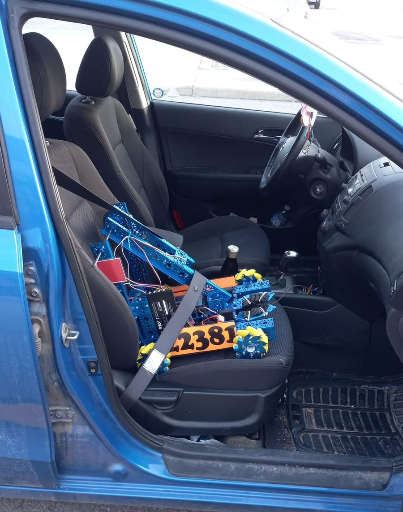

# Hi I'm Kristina! 👋

I'm a Computer Science student at Western University. I first got into programming when I joined my high school's robotics club and realized how cool it was to see my code come to life in the physical world. I met lots of amazing people in that club and was lucky enough to be trusted by them to lead our robot design for the 2023 FIRST Tech Challenge, where we won 1st place at the regional competition!

Since then, I've had the chance to learn about more and more areas of computer science. What has kept me interested throughout is the problem-solving. I've always loved logic puzzles, and coding feels like an endless supply of them. I enjoy breaking down complicated problems, finding solutions, and then spending probably way too much time trying to make those solutions just a little bit better.

More recently, I've been exploring web development and enjoying the opportunity to build things that people can actually use. I'm currently working on expanding my front-end skills, experimenting with new technologies, and turning what I'm learning into real projects.

## What I'm Working On
- **CSUS (Computer Science Undergraduate Society) Project** - Leading a student development team in programming a robotic 3-axis gimbal that rotates and aims a Nerf gun at balloons, as part of a larger CSUS project aiming to bring Bloons Tower Defense to life!
- **[LUME Projects Inc. Website](https://kristinabbbb.github.io/LUME-Website/)** - Developing a responsive buisness website using HTML, CSS, and JavaScript. [Source Code](https://github.com/KristinaBBBB/LUME-Website)
- **Full Stack Web Development** - Working through freeCodeCamp's curriculum and building projects to apply what I'm learning.
- **University Projects** - Exploring software engineering, data structures and data science through coursework and team projects.

## Featured Projects
- **[Personal Portfolio](https://kristinabatrak.com)** - My personal website, built from scratch to showcase my projects and web development skills. [Source Code](https://github.com/KristinaBBBB/Portfolio)
- **[EchoLight](https://devpost.com/software/echolight)** - An accessibility-focused collaborative hackathon project designed to help deaf and hard-of-hearing drivers recognize important sounds around them. I developed the Python-based audio detection system and integrated it with the Spring Boot backend. [Source Code](https://github.com/KristinaBBBB/ElleHacks-EchoLight)
- **Clementine** - The FIRST Tech Challenge robot famously responsible for inspiring my love for computer science and, less notably, winning our team 1st place at the regional competition. [View Engineering Process](https://drive.google.com/file/d/1b2xdVuxbYPJF-jOz657fEGKwj7kVbe39/view?usp=sharing)

## Technologies I've Worked With
**Languages**: Java, Python, C, HTML, CSS, JavaScript, ARM Assembly

**Libraries**: NumPy, SciPy, pandas, Matplotlib

**Tools**: Git, GitHub, GitLab, Linux/Unix, VS Code, Eclipse, CLion, NetBeans

I'm always interested in learning new technologies and finding opportunities to put what I've learned into practice.

## Connect With Me
- **Portfolio**: https://kristinabatrak.com/
- **LinkedIn**: https://www.linkedin.com/in/kristina-batrak/
